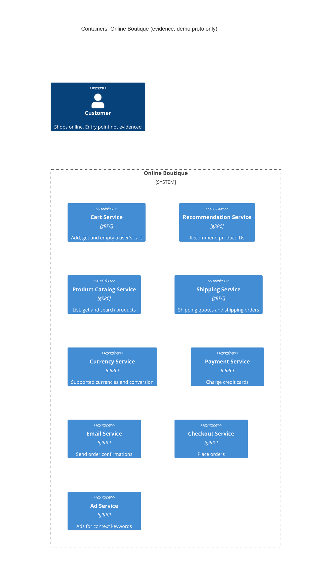

# Task 1 – Run A: Recovered C4 container architecture (Online Boutique)

## 1. Agent

- Product: Claude Code (VS Code extension)
- Model: Claude Opus 5.5 (`claude-opus-5-5`)

## 2. Files read

- `prompts/1-recover-architecture.md` (task file)
- `system/online-boutique/protos/demo.proto` (only evidence file)

## 3. Containers table

The proto defines nine gRPC services in package `hipstershop` (`demo.proto` line 17). That each `service` is deployed as its own container is an **[Inferred]** reading. The proto defines interfaces only, not how they are deployed.

| Container | Technology / language | Responsibility | Evidence |
|---|---|---|---|
| Cart Service | gRPC / Protocol Buffers (proto3). Implementation language: not evidenced in the provided files | Add items to a user's cart, get the cart, empty the cart (`AddItem`, `GetCart`, `EmptyCart`) | `system/online-boutique/protos/demo.proto` (`service CartService`, lines 23–27) |
| Recommendation Service | gRPC / proto3. Language: not evidenced | List recommended product IDs for a user and a set of products (`ListRecommendations`) | `demo.proto` (`service RecommendationService`, lines 56–58) |
| Product Catalog Service | gRPC / proto3. Language: not evidenced | List, get and search products (`ListProducts`, `GetProduct`, `SearchProducts`) | `demo.proto` (`service ProductCatalogService`, lines 71–75) |
| Shipping Service | gRPC / proto3. Language: not evidenced | Quote shipping cost and ship an order, returning a tracking ID (`GetQuote`, `ShipOrder`) | `demo.proto` (`service ShippingService`, lines 107–110) |
| Currency Service | gRPC / proto3. Language: not evidenced | List supported currencies and convert `Money` between currencies (`GetSupportedCurrencies`, `Convert`) | `demo.proto` (`service CurrencyService`, lines 140–143) |
| Payment Service | gRPC / proto3. Language: not evidenced | Charge a credit card for an amount and return a transaction ID (`Charge`) | `demo.proto` (`service PaymentService`, lines 177–179) |
| Email Service | gRPC / proto3. Language: not evidenced | Send an order confirmation to an email address (`SendOrderConfirmation`) | `demo.proto` (`service EmailService`, lines 199–201) |
| Checkout Service | gRPC / proto3. Language: not evidenced | Place an order for a user (address, email, credit card, currency) and return an `OrderResult` (`PlaceOrder`) | `demo.proto` (`service CheckoutService`, lines 224–226) |
| Ad Service | gRPC / proto3. Language: not evidenced | Return ads for a set of context keywords (`GetAds`) | `demo.proto` (`service AdService`, lines 243–245) |

**Data stores:** none. Not evidenced in the provided files.
**Message brokers:** none. Not evidenced in the provided files.
**Frontend / UI container:** not evidenced in the provided files. The proto defines no UI service.

## 4. Dependencies table

A `.proto` file declares what each service **offers**. It does not declare which service **calls** which, so no runtime dependency is evidenced.

| Caller → Callee | Protocol | Evidence |
|---|---|---|
| — (none evidenced) | — | `demo.proto` defines service interfaces only. It names no clients or service addresses |

Candidate dependencies that the message types hint at are listed under **Gaps** and are not in the diagram.

## 5. Mermaid diagram

The diagram contains no `Rel` lines, because the dependencies table has no evidenced dependency. The `Person` is included because the diagram format requires an end user. How the user reaches the system (which entry point, which protocol) is not evidenced.

## 6. Gaps

| Gap | Why it cannot be settled from `demo.proto` | File that would settle it |
|---|---|---|
| Who calls whom (all runtime dependencies) | A proto declares servers, not clients | Kubernetes manifests with `*_SERVICE_ADDR` env vars, e.g. `system/online-boutique/kubernetes-manifests/*.yaml`, or each service's source code |
| **[Inferred]** Checkout Service → Cart, Product Catalog, Currency, Shipping, Payment, Email | `PlaceOrderRequest` carries `CreditCardInfo`, `Address` and `email` (lines 228–235). `OrderResult` holds `shipping_tracking_id`, `shipping_cost` and `items` (lines 208–214). These match the inputs and outputs of `Charge`, `ShipOrder`, `GetQuote` and `SendOrderConfirmation`. That suggests orchestration, but it does not prove it | `kubernetes-manifests/checkoutservice.yaml` (env vars) and the checkout service source |
| **[Inferred]** Recommendation Service → Product Catalog Service | `ListRecommendationsRequest` takes `product_ids` (lines 60–63). Product categories are described as usable "to look up other related products" (lines 84–86) | `kubernetes-manifests/recommendationservice.yaml` and the recommendation service source |
| Existence of a frontend / web UI and how the customer reaches the system (HTTP?) | No UI service is in the proto | `kubernetes-manifests/frontend.yaml` and the frontend source |
| Data stores (e.g. where carts are kept) | The proto has no storage concepts | `kubernetes-manifests/` (e.g. a cart database deployment) and the cart service source |
| Message brokers / async messaging | Only unary gRPC RPCs are defined | Deployment manifests |
| Implementation language of each service | The proto is language-neutral. Only a Go package option is set (line 19), which says nothing about the server language | Each service's source folder / Dockerfile under `system/online-boutique/src/` |
| External systems (real payment provider, email server) | `Charge` and `SendOrderConfirmation` exist, but whether they call outside systems is not shown | Payment and email service source and their manifests |
| Whether each proto `service` is a separate deployable container | One proto file could be served by fewer processes | `kubernetes-manifests/` (one Deployment per service?) |
