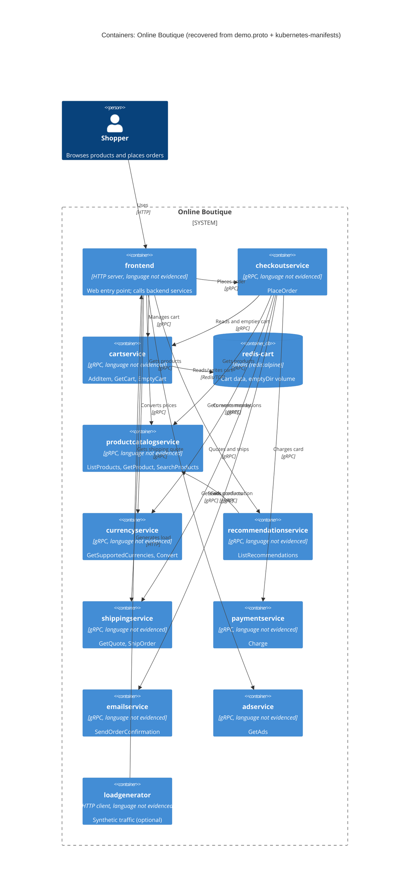

# Task 1 – Run B: Recovered C4 container architecture (Online Boutique)

## 1. Agent

- Product: Claude Code (VS Code extension)
- Model: Claude Opus 5.5 (`claude-opus-5-5`)

## 2. Files read

Task instructions: `prompts/1-recover-architecture.md`

Evidence:

- `system/online-boutique/protos/demo.proto`
- `system/online-boutique/kubernetes-manifests/README.md`
- `system/online-boutique/kubernetes-manifests/kustomization.yaml`
- `system/online-boutique/kubernetes-manifests/adservice.yaml`
- `system/online-boutique/kubernetes-manifests/cartservice.yaml`
- `system/online-boutique/kubernetes-manifests/checkoutservice.yaml`
- `system/online-boutique/kubernetes-manifests/currencyservice.yaml`
- `system/online-boutique/kubernetes-manifests/emailservice.yaml`
- `system/online-boutique/kubernetes-manifests/frontend.yaml`
- `system/online-boutique/kubernetes-manifests/loadgenerator.yaml`
- `system/online-boutique/kubernetes-manifests/paymentservice.yaml`
- `system/online-boutique/kubernetes-manifests/productcatalogservice.yaml`
- `system/online-boutique/kubernetes-manifests/recommendationservice.yaml`
- `system/online-boutique/kubernetes-manifests/shippingservice.yaml`

## 3. Containers table

Implementation languages are **not evidenced** in these files. The manifests only give image names such as `image: cartservice`, and the README says skaffold fills in the real tags. The "Technology" column therefore lists only what the files show: the exposed protocol, the port, and the image where it is a public one.

| Container | Technology / language | Responsibility | Evidence |
|---|---|---|---|
| `frontend` | Language not evidenced; HTTP server on :8080, exposed via `LoadBalancer` Service `frontend-external` :80 | Web entry point for shoppers; calls the backend services | `kubernetes-manifests/frontend.yaml` (Deployment `frontend`, Service `frontend-external` `type: LoadBalancer`, port name `http`, `httpGet /_healthz`) |
| `cartservice` | Language not evidenced; gRPC server on :7070 | Store and return a user's cart: `AddItem`, `GetCart`, `EmptyCart` | `protos/demo.proto` (`service CartService`); `kubernetes-manifests/cartservice.yaml` (Service port name `grpc`, `grpc` probes) |
| `redis-cart` | Redis (`redis:alpine`), TCP :6379, `emptyDir` volume at `/data` | Data store for cart contents | `kubernetes-manifests/cartservice.yaml` (Deployment `redis-cart`, `image: redis:alpine`, `volumes: redis-data emptyDir`) |
| `productcatalogservice` | Language not evidenced; gRPC server on :3550 | List, get and search products: `ListProducts`, `GetProduct`, `SearchProducts` | `protos/demo.proto` (`service ProductCatalogService`); `kubernetes-manifests/productcatalogservice.yaml` (port name `grpc`) |
| `currencyservice` | Language not evidenced; gRPC server on :7000 | Supported currencies and money conversion: `GetSupportedCurrencies`, `Convert` | `protos/demo.proto` (`service CurrencyService`); `kubernetes-manifests/currencyservice.yaml` (port name `grpc`) |
| `recommendationservice` | Language not evidenced; gRPC server on :8080 | Recommend product IDs: `ListRecommendations` | `protos/demo.proto` (`service RecommendationService`); `kubernetes-manifests/recommendationservice.yaml` (port name `grpc`) |
| `shippingservice` | Language not evidenced; gRPC server on :50051 | Shipping quotes and shipping orders: `GetQuote`, `ShipOrder` | `protos/demo.proto` (`service ShippingService`); `kubernetes-manifests/shippingservice.yaml` (port name `grpc`) |
| `checkoutservice` | Language not evidenced; gRPC server on :5050 | Places an order: `PlaceOrder` returns `OrderResult` | `protos/demo.proto` (`service CheckoutService`); `kubernetes-manifests/checkoutservice.yaml` (port name `grpc`) |
| `paymentservice` | Language not evidenced; gRPC server on :50051 | Charge a credit card: `Charge` returns `transaction_id` | `protos/demo.proto` (`service PaymentService`); `kubernetes-manifests/paymentservice.yaml` (port name `grpc`) |
| `emailservice` | Language not evidenced; gRPC server on container :8080, Service :5000 | Send order confirmation: `SendOrderConfirmation` | `protos/demo.proto` (`service EmailService`); `kubernetes-manifests/emailservice.yaml` (Service `port: 5000`, `targetPort: 8080`, name `grpc`) |
| `adservice` | Language not evidenced; gRPC server on :9555 | Return ads for context keywords: `GetAds` | `protos/demo.proto` (`service AdService`); `kubernetes-manifests/adservice.yaml` (port name `grpc`) |
| `loadgenerator` | Language not evidenced (`image: loadgenerator`); HTTP client; `busybox` init container | Generates synthetic user traffic against `frontend` (`USERS=10`, `RATE=1`). Optional: commented out in `kustomization.yaml` | `kubernetes-manifests/loadgenerator.yaml` (`FRONTEND_ADDR`, `USERS`, `RATE`); `kubernetes-manifests/kustomization.yaml` (line 24, `# - loadgenerator.yaml`) |

## 4. Dependencies table

How the protocol was determined: each caller only gives a `host:port` address in an environment variable. The protocol comes from the **callee's** Kubernetes Service port name (`grpc` / `http` / `tcp-redis`) and probe type, and the gRPC interface comes from `demo.proto`.

| Caller → Callee | Protocol | Evidence (file · symbol / env var) |
|---|---|---|
| Shopper → `frontend` | HTTP | `kubernetes-manifests/frontend.yaml` · Service `frontend-external` (`type: LoadBalancer`, port name `http`, 80→8080) |
| `loadgenerator` → `frontend` | HTTP | `kubernetes-manifests/loadgenerator.yaml` · `FRONTEND_ADDR=frontend:80`; init container `wget http://${FRONTEND_ADDR}` |
| `frontend` → `productcatalogservice` | gRPC | `kubernetes-manifests/frontend.yaml` · `PRODUCT_CATALOG_SERVICE_ADDR=productcatalogservice:3550` |
| `frontend` → `currencyservice` | gRPC | `kubernetes-manifests/frontend.yaml` · `CURRENCY_SERVICE_ADDR=currencyservice:7000` |
| `frontend` → `cartservice` | gRPC | `kubernetes-manifests/frontend.yaml` · `CART_SERVICE_ADDR=cartservice:7070` |
| `frontend` → `recommendationservice` | gRPC | `kubernetes-manifests/frontend.yaml` · `RECOMMENDATION_SERVICE_ADDR=recommendationservice:8080` |
| `frontend` → `shippingservice` | gRPC | `kubernetes-manifests/frontend.yaml` · `SHIPPING_SERVICE_ADDR=shippingservice:50051` |
| `frontend` → `checkoutservice` | gRPC | `kubernetes-manifests/frontend.yaml` · `CHECKOUT_SERVICE_ADDR=checkoutservice:5050` |
| `frontend` → `adservice` | gRPC | `kubernetes-manifests/frontend.yaml` · `AD_SERVICE_ADDR=adservice:9555` |
| `checkoutservice` → `productcatalogservice` | gRPC | `kubernetes-manifests/checkoutservice.yaml` · `PRODUCT_CATALOG_SERVICE_ADDR=productcatalogservice:3550` |
| `checkoutservice` → `shippingservice` | gRPC | `kubernetes-manifests/checkoutservice.yaml` · `SHIPPING_SERVICE_ADDR=shippingservice:50051` |
| `checkoutservice` → `paymentservice` | gRPC | `kubernetes-manifests/checkoutservice.yaml` · `PAYMENT_SERVICE_ADDR=paymentservice:50051` |
| `checkoutservice` → `emailservice` | gRPC | `kubernetes-manifests/checkoutservice.yaml` · `EMAIL_SERVICE_ADDR=emailservice:5000` |
| `checkoutservice` → `currencyservice` | gRPC | `kubernetes-manifests/checkoutservice.yaml` · `CURRENCY_SERVICE_ADDR=currencyservice:7000` |
| `checkoutservice` → `cartservice` | gRPC | `kubernetes-manifests/checkoutservice.yaml` · `CART_SERVICE_ADDR=cartservice:7070` |
| `recommendationservice` → `productcatalogservice` | gRPC | `kubernetes-manifests/recommendationservice.yaml` · `PRODUCT_CATALOG_SERVICE_ADDR=productcatalogservice:3550` |
| `cartservice` → `redis-cart` | Redis protocol over TCP | `kubernetes-manifests/cartservice.yaml` · `REDIS_ADDR=redis-cart:6379`; Service `redis-cart` port name `tcp-redis` |

## 5. Mermaid diagram

The `Rel` labels describe what each call is for. **[Inferred]** They are based on the RPC names in `demo.proto`; the files do not show which RPCs each caller actually invokes.

## 6. Gaps

| Gap | Why it is open | File(s) that would settle it |
|---|---|---|
| Implementation language/framework of every service | Manifests only reference placeholder image names (`image: frontend`, …); README says skaffold fills in tags | `system/online-boutique/src/<service>/Dockerfile` or source files; `skaffold.yaml` |
| `shoppingassistantservice` | `frontend.yaml` sets `SHOPPING_ASSISTANT_SERVICE_ADDR=shoppingassistantservice:80`, but no manifest for it is in the evidence, and `ENABLE_ASSISTANT` is commented out. Kept out of the diagram. | `kustomize/components/shopping-assistant/`; `src/frontend` code |
| Optional "packaging service" (external) | Only a commented-out `PACKAGING_SERVICE_URL` in `frontend.yaml` | `src/frontend` code and the related kustomize component |
| Which RPCs each caller actually calls | Env vars prove a configured address, not that it is used or which RPCs are called (for example, does `checkoutservice` call `EmptyCart` or `GetCart`?) | `src/frontend/`, `src/checkoutservice/`, `src/recommendationservice/` client code |
| Data source of `productcatalogservice`, `currencyservice`, `adservice` | No database or volume is declared for them in the manifests. Not evidenced whether the data is in memory, in files, or elsewhere. | Service source code; `kustomize/components/alloydb/`, `kustomize/components/spanner/` |
| External systems (real payment provider, SMTP/email provider) | No external endpoints in the manifests. No `System_Ext` is drawn because none is evidenced. | `src/paymentservice/`, `src/emailservice/` |
| Cart data durability | `redis-cart` uses an `emptyDir` volume. Whether loss on pod reschedule is acceptable, or is replaced in production (e.g. `memorystore` component in `kustomization.yaml`), is not evidenced | `kustomize/components/memorystore/`; deployment docs |
| Whether gRPC calls are encrypted/mTLS (Istio) | Only an annotation `sidecar.istio.io/rewriteAppHTTPProbers` hints at Istio; no mesh config in evidence | Istio / service-mesh manifests (e.g. `istio-manifests/`) |
| `loadgenerator` in production deployments | It is commented out in `kustomization.yaml` ("During development … skaffold"). It is included in the diagram because a manifest exists, and is marked optional | `skaffold.yaml`; `release/` manifests |
| Session handling / user identity | `frontend` probes use a `shop_session-id` cookie; where sessions are stored is not evidenced | `src/frontend/` |
