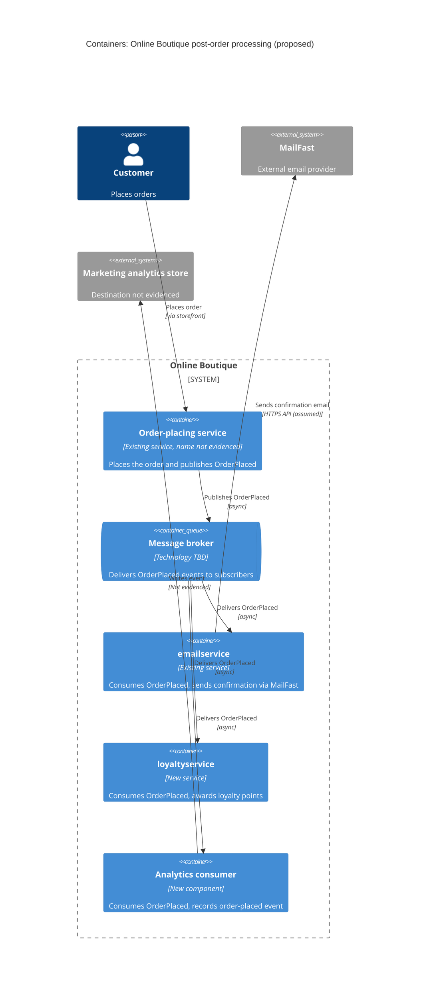

> Agent: Claude Code (Anthropic) · Model: Claude Opus 5.5 (`claude-opus-5-5`) · Run: 2a (zero-shot, context: none)

# ADR-0002: ใช้ event "OrderPlaced" แบบ asynchronous publish/subscribe สำหรับงานหลังสั่งซื้อ

- **Status:** Proposed
- **Date:** 2026-10-22
- **Deciders:** ทีมสถาปัตยกรรม Online Boutique (รายชื่อผู้ตัดสินใจ: ดู Open questions)

## Context and problem

ADR นี้เขียนจาก requirement เพียงอย่างเดียว (`context: none`) จึงไม่ได้อ้างอิงโค้ดหรือ manifest ของระบบ ข้อเท็จจริงเกี่ยวกับระบบปัจจุบันที่ไม่ได้ระบุใน requirement จะทำเครื่องหมาย **[Inferred]** หรือย้ายไปไว้ใน Open questions

สิ่งที่ requirement กำหนด หลังจากลูกค้าสั่งซื้อสำเร็จ ระบบต้อง:

1. ส่งอีเมลยืนยันคำสั่งซื้อผ่าน **MailFast** ซึ่งเป็น external email provider รายใหม่ แทนที่ logic จำลอง (mock) ใน `emailservice`
2. ให้คะแนนสะสมผ่าน `loyaltyservice` ซึ่งเป็น service ใหม่ที่ยังต้องสร้าง
3. บันทึก analytics event "order placed" ให้ทีมการตลาด
4. ทีมการตลาดคาดว่าปีหน้าจะมีงานหลังสั่งซื้อเพิ่มอีก: SMS, fraud scoring และการอัปเดต recommendations

ปัญหาที่ต้องตัดสินใจ: **service ที่ทำการสั่งซื้อควรเรียกงานหลังสั่งซื้อเหล่านี้อย่างไร** เพื่อให้ (ก) การสั่งซื้อไม่ช้าลงหรือล้มเหลวเพราะ dependency ภายนอก เช่น MailFast และ (ข) เพิ่มงานหลังสั่งซื้อใหม่ได้โดยไม่ต้องแก้ service ที่ทำการสั่งซื้อทุกครั้ง

- **[Inferred]** จากคำว่า "replaces the mock emailservice logic" ปัจจุบันน่าจะมี service ที่ทำการสั่งซื้อเรียก `emailservice` โดยตรงแบบ synchronous หลังสั่งซื้อ ข้อนี้ไม่ได้ยืนยันจากไฟล์ใด
- จำนวนคำสั่งซื้อต่อวินาที, latency budget, SLA ของ MailFast และข้อกำหนดด้านความสดของข้อมูล analytics: **Not evidenced in the provided files** (ดู Open questions)

## Decision drivers

เรียงจากสำคัญที่สุด:

- **Modifiability / extensibility:** ปีหน้าจะมีงานหลังสั่งซื้อเพิ่มอย่างน้อย 3 อย่าง การเพิ่มงานใหม่ไม่ควรต้องแก้และ deploy service ที่ทำการสั่งซื้อ
- **Availability ของการสั่งซื้อ:** MailFast เป็นระบบภายนอกที่เราควบคุมไม่ได้ ถ้า MailFast, `loyaltyservice` หรือ analytics ล่ม การสั่งซื้อยังต้องสำเร็จ
- **Performance (latency ของการสั่งซื้อ):** ลูกค้าไม่ควรต้องรอให้ส่งอีเมล ให้คะแนน และบันทึก analytics เสร็จก่อนเห็นหน้ายืนยัน
- **Reliability (ไม่ทำงานหาย/ไม่ทำซ้ำ):** อีเมลยืนยันและคะแนนสะสมต้องเกิดขึ้นจริงสำหรับทุกคำสั่งซื้อ และไม่ควรให้คะแนนซ้ำ
- **Cost / operational complexity:** จำนวนชิ้นส่วนใหม่ที่ทีมต้องดูแล (ทักษะทีมด้าน message broker: ดู Open questions)
- **Testability / observability:** ติดตามได้ว่าคำสั่งซื้อหนึ่งรายการผ่านงานหลังสั่งซื้อใดไปแล้วบ้าง

## Considered options

1. **Option A: Synchronous orchestration ใน service ที่ทำการสั่งซื้อ** เรียก `emailservice` (ที่เปลี่ยนไปเรียก MailFast), `loyaltyservice` และ analytics ทีละตัวผ่าน gRPC ภายใน flow การสั่งซื้อ
2. **Option B: Asynchronous publish/subscribe ด้วย event `OrderPlaced` ผ่าน message broker** service ที่ทำการสั่งซื้อ publish event หนึ่งครั้ง แล้ว `emailservice` (MailFast adapter), `loyaltyservice` และ analytics consumer แต่ละตัว subscribe แยกกัน
3. **Option C: Post-order orchestrator service แยกต่างหาก** service ที่ทำการสั่งซื้อส่งคำขอเดียวไปยัง orchestrator ใหม่ (ผ่าน queue หรือ gRPC แบบ fire-and-forget) แล้ว orchestrator เรียกงานหลังสั่งซื้อแต่ละตัวตามลำดับที่กำหนด

### Pros and cons of the options

| Option | Pros | Cons |
|---|---|---|
| A: Synchronous orchestration | เรียบง่าย ใช้รูปแบบ gRPC เดิม ไม่มี infrastructure ใหม่; ลำดับและผลลัพธ์ของแต่ละงานเห็นชัดในโค้ดเดียว; debug ง่าย | latency ของการสั่งซื้อเท่ากับผลรวมของทุก call (รวม MailFast ที่อยู่นอกระบบ); MailFast ล่ม → ต้องเลือกระหว่างให้สั่งซื้อล้มเหลวหรือทิ้งงานไปเงียบ ๆ; ทุกงานใหม่ (SMS, fraud, recommendations) ต้องแก้และ deploy service ที่ทำการสั่งซื้อ → coupling สูงขึ้นเรื่อย ๆ; ต้องเขียน retry เองในทุก call |
| B: Pub/sub event `OrderPlaced` | service ที่ทำการสั่งซื้อไม่รู้จัก consumer → เพิ่ม SMS/fraud/recommendations ได้แค่เพิ่ม subscriber; การสั่งซื้อไม่รอและไม่ล้มเพราะ MailFast; broker เก็บ event ไว้ให้ consumer retry ได้เมื่อกลับมา; consumer แต่ละตัว scale และ deploy แยกกัน; analytics ได้ event stream โดยตรง | ต้องติดตั้งและดูแล message broker (cost, ops); eventual consistency: อีเมลและคะแนนมาถึงช้ากว่าการสั่งซื้อเล็กน้อย; ต้องรับมือ at-least-once delivery → consumer ต้อง idempotent (สำคัญมากกับคะแนนสะสม); ต้องกัน dual-write (บันทึกคำสั่งซื้อสำเร็จแต่ publish ล้มเหลว); trace ข้าม service ยากขึ้น; ต้องจัดการ schema version ของ event |
| C: Post-order orchestrator | service ที่ทำการสั่งซื้อพึ่งพาแค่ปลายทางเดียว; ลำดับงานและเงื่อนไข (เช่น fraud scoring ก่อนให้คะแนน) อยู่ในที่เดียว เห็นภาพรวมง่าย; การสั่งซื้อไม่ต้องรอถ้าเรียกแบบ async | orchestrator ต้องแก้ทุกครั้งที่มีงานใหม่ → ย้าย coupling จาก service ที่ทำการสั่งซื้อไปไว้ที่ orchestrator; เป็นอีกจุดที่อาจเป็น single point of failure และ bottleneck; ถ้าใช้ queue ก็ยังต้องมี broker เหมือน B แต่ได้ความยืดหยุ่นน้อยกว่า; ต้องสร้างและดูแล service ใหม่อีกตัว |

## Decision

เลือก **Option B: Asynchronous publish/subscribe ด้วย event `OrderPlaced`**

เหตุผลเทียบกับ decision drivers:

- **Modifiability:** เป็นตัวเลือกเดียวที่การเพิ่มงานหลังสั่งซื้อใหม่ (SMS, fraud scoring, recommendations) ทำได้โดย**ไม่ต้องแก้** service ที่ทำการสั่งซื้อหรือ service กลางใด ๆ ซึ่งตรงกับความคาดหวังของทีมการตลาดสำหรับปีหน้า
- **Availability และ performance:** การสั่งซื้อสำเร็จทันทีที่บันทึกคำสั่งซื้อและ publish event แล้ว ไม่ขึ้นกับความพร้อมใช้งานหรือ latency ของ MailFast, `loyaltyservice` หรือ analytics
- **Reliability:** broker เก็บ event ไว้จนกว่า consumer จะประมวลผลสำเร็จ ทำให้ retry ได้เมื่อ MailFast ขัดข้องชั่วคราว

รายละเอียดการออกแบบที่เป็นส่วนหนึ่งของการตัดสินใจนี้:

- event `OrderPlaced` มีอย่างน้อย `order_id` (ใช้เป็น idempotency key), ข้อมูลลูกค้าที่ต้องใช้ส่งอีเมล, รายการสินค้าและยอดรวม และมี field สำหรับ schema version
- ใช้ **transactional outbox** หรือกลไกเทียบเท่า เพื่อกันกรณีบันทึกคำสั่งซื้อแล้วแต่ publish event ไม่สำเร็จ (วิธีที่ใช้ได้ขึ้นอยู่กับว่า service ที่ทำการสั่งซื้อมี data store หรือไม่: ดู Open questions)
- consumer แต่ละตัวมี subscription/queue ของตัวเอง, retry แบบ exponential backoff และ dead-letter queue
- `emailservice` กลายเป็น consumer ที่เป็น adapter ไปยัง MailFast (เก็บ credential และ rate limit ของ MailFast ไว้ที่เดียว)
- `loyaltyservice` ต้อง idempotent ตาม `order_id` เพื่อไม่ให้คะแนนซ้ำ
- เลือกเทคโนโลยี broker (เช่น RabbitMQ, Kafka, Google Cloud Pub/Sub, NATS) ในขั้นถัดไป: ดู Open questions

ภาพรวม (โครงสร้างที่เสนอ ไม่ใช่สถาปัตยกรรมปัจจุบัน):

## Consequences

- **Positive:** เพิ่มงานหลังสั่งซื้อใหม่ได้ด้วยการเพิ่ม subscriber เท่านั้น ไม่ต้องแก้ service ที่ทำการสั่งซื้อ (quality attribute: modifiability)
- **Positive:** MailFast, `loyaltyservice` หรือ analytics ขัดข้องไม่ทำให้การสั่งซื้อล้มเหลว (quality attribute: availability)
- **Positive:** latency ของการสั่งซื้อไม่รวมเวลาเรียก MailFast และงานอื่น ๆ (quality attribute: performance)
- **Positive:** consumer แต่ละตัว scale และ deploy อิสระ; ทีมใหม่สร้าง `loyaltyservice` ได้โดยไม่ต้องประสานกับ release ของ service ที่ทำการสั่งซื้อ (quality attribute: deployability, scalability)
- **Positive:** analytics ได้ event stream มาตรฐานที่นำไปใช้ต่อได้ (quality attribute: interoperability)
- **Negative:** ต้องมี message broker ใหม่ให้ติดตั้ง, monitor และดูแล (quality attribute: cost, operability)
- **Negative:** อีเมลยืนยันและคะแนนสะสมเป็น eventually consistent ลูกค้าอาจเห็นคะแนนช้ากว่าการสั่งซื้อ (quality attribute: consistency / usability)
- **Negative:** debug และ trace งานของคำสั่งซื้อหนึ่งรายการยากขึ้นเพราะข้ามหลาย service แบบ async (quality attribute: observability, testability)
- **Negative:** event schema กลายเป็น contract ที่ต้องดูแลเรื่อง version และ backward compatibility (quality attribute: modifiability ระยะยาว)
- **Risks and mitigations:**
  - *Event หาย (บันทึกคำสั่งซื้อแล้วแต่ publish ไม่สำเร็จ)* → transactional outbox หรือ retry ที่ publisher พร้อม alert
  - *ประมวลผลซ้ำจาก at-least-once delivery (ให้คะแนนซ้ำ, ส่งอีเมลซ้ำ)* → consumer idempotent ตาม `order_id`; ตรวจว่า MailFast รองรับ idempotency key หรือไม่
  - *MailFast ล่มนานหรือติด rate limit* → retry แบบ backoff, dead-letter queue, alert และ replay จาก DLQ
  - *Broker เป็น single point of failure ใหม่* → ตั้งค่า broker แบบ replicated/HA และให้ outbox เก็บ event ไว้ระหว่าง broker ล่ม
  - *Schema เปลี่ยนแล้ว consumer พัง* → ใส่ version ใน event, เพิ่ม field แบบ backward compatible เท่านั้น, ใช้ contract test
  - *Fraud scoring ในอนาคตอาจต้อง**บล็อก**คำสั่งซื้อ ซึ่ง pub/sub หลังสั่งซื้อทำไม่ได้* → ถ้าต้องบล็อกก่อนยืนยันคำสั่งซื้อ ให้ทำเป็น synchronous step ใน flow การสั่งซื้อและบันทึกเป็น ADR แยก

## Validation

- **Load test:** วัด latency ของการสั่งซื้อ (p95/p99) ก่อนและหลังเปลี่ยน เป้าหมาย: latency ไม่เพิ่มขึ้นจากเดิม (ตัวเลขเป้าหมายจริง: ดู Open questions)
- **Fault injection:** ปิด MailFast (หรือ mock ที่จำลอง timeout), `loyaltyservice` และ analytics consumer ทีละตัว แล้วยืนยันว่า (1) การสั่งซื้อยังสำเร็จ 100% และ (2) เมื่อ dependency กลับมา งานที่ค้างถูกประมวลผลครบ
- **Idempotency test:** ส่ง event `OrderPlaced` เดิมซ้ำ แล้วยืนยันว่าคะแนนถูกให้ครั้งเดียวและอีเมลส่งครั้งเดียว
- **Metrics ใน production:** consumer lag ต่อ subscription, จำนวนข้อความใน DLQ, อัตราส่งอีเมลสำเร็จผ่าน MailFast, เวลาตั้งแต่สั่งซื้อจนอีเมลถึง (end-to-end delay)
- **Modifiability check:** เมื่อเพิ่มงานแรกของปีหน้า (เช่น SMS) ยืนยันว่าไม่ต้องแก้โค้ดของ service ที่ทำการสั่งซื้อ
- **Review date:** ทบทวน ADR นี้หลังใช้งานจริง 3 เดือน หรือก่อนเริ่มทำ fraud scoring (แล้วแต่อย่างใดถึงก่อน)

## Open questions

ข้อมูลต่อไปนี้ไม่ได้ให้ไว้ใน requirement จึงไม่ได้สมมติค่าขึ้นเอง:

1. service ใดเป็นผู้ทำการสั่งซื้อและเรียก `emailservice` ในปัจจุบัน และเรียกด้วย protocol อะไร? (ข้อสันนิษฐานว่าเรียกแบบ synchronous เป็น **[Inferred]**)
2. service ที่ทำการสั่งซื้อมี data store ของตัวเองหรือไม่? (มีผลต่อการทำ transactional outbox)
3. ปริมาณคำสั่งซื้อ (ปกติ/ช่วงพีค) และ latency budget ของการสั่งซื้อคือเท่าไร?
4. SLA, rate limit, วิธียืนยันตัวตน และการรองรับ idempotency key ของ MailFast API คืออะไร? MailFast มี API แบบไหน (REST/SMTP)?
5. อีเมลยืนยันต้องถึงลูกค้าภายในกี่วินาที/นาที? คะแนนสะสมต้องแสดงทันทีหรือยอมให้ช้าได้?
6. ทีมการตลาดต้องการ analytics event ไปเก็บที่ไหน (data warehouse, analytics SaaS ฯลฯ) และต้องการความสดของข้อมูลระดับใด?
7. มีข้อกำหนดด้าน privacy/PDPA สำหรับการส่งข้อมูลลูกค้า (อีเมล, รายการสั่งซื้อ) ไปยัง MailFast และระบบ analytics หรือไม่?
8. ทีมมีทักษะและงบประมาณสำหรับ message broker แบบใด และ deploy อยู่บนแพลตฟอร์มใด (มีผลต่อการเลือก RabbitMQ / Kafka / managed Pub/Sub)?
9. fraud scoring ในปีหน้าต้องบล็อกคำสั่งซื้อก่อนยืนยันหรือเป็นแค่การตรวจหลังสั่งซื้อ?
10. ใครเป็น deciders และใครเป็นเจ้าของ `loyaltyservice` และ analytics consumer?
