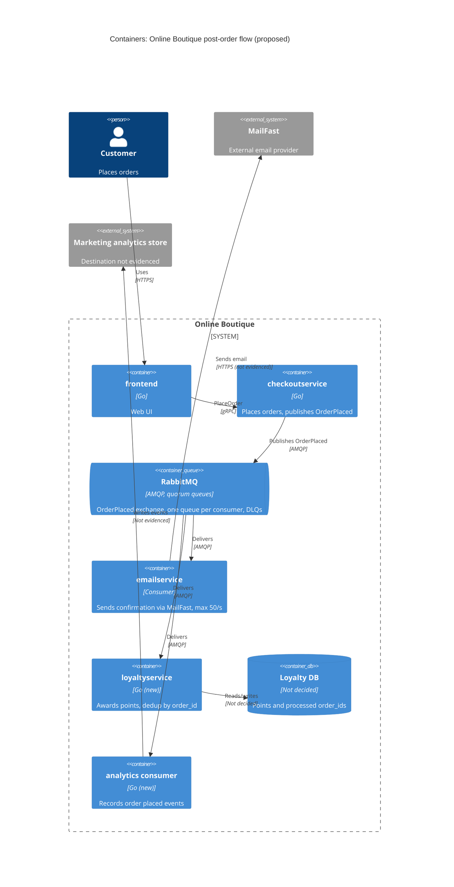

> Agent: Claude Code · Model: Claude Opus 5.5 (`claude-opus-5-5`) · Run: b (มี context: `docs/scenario.md`, `docs/adr/0001-use-redis-for-cart-storage.md`, `system/online-boutique/src/checkoutservice/main.go`)

# ADR-0002: Publish an "OrderPlaced" event to RabbitMQ for post-order actions

- **Status:** Proposed
- **Date:** 2026-10-22
- **Deciders:** ทีมพัฒนา Online Boutique (4 developers) — ผู้มีอำนาจอนุมัติขั้นสุดท้าย: Not evidenced in the provided files

## Context and problem

Requirement R-12 (`docs/scenario.md`) กำหนดว่าหลังสั่งซื้อสำเร็จ ระบบต้อง (1) ส่งอีเมลยืนยันผ่าน **MailFast** แทน logic mock ของ `emailservice` (2) ให้ loyalty points ผ่าน `loyaltyservice` ตัวใหม่ (3) บันทึก analytics event "order placed" และ marketing คาดว่าจะมี post-order action เพิ่มอีกในปีหน้า (SMS, fraud scoring, recommendations update)

**สภาพปัจจุบัน (จากโค้ด):**

| ข้อเท็จจริง | หลักฐาน |
|---|---|
| `PlaceOrder` เรียก `chargeCard` → `shipOrder` → `emptyUserCart` → `sendOrderConfirmation` ตามลำดับ แบบ synchronous ภายใน request เดียว | `system/online-boutique/src/checkoutservice/main.go` (`PlaceOrder`, บรรทัด 252–277) |
| ถ้าส่งอีเมลล้มเหลว จะแค่ `log.Warnf` และ order ยังสำเร็จ | `main.go` บรรทัด 273–277 |
| ทุก dependency เป็น gRPC client ที่ผูกกับ env var แบบ `mustMapEnv` (เช่น `EMAIL_SERVICE_ADDR`) — เพิ่ม action ใหม่ = แก้ `checkoutService` struct, `main()` และ `PlaceOrder` | `main.go` (`checkoutService` struct บรรทัด 66–86, `main` บรรทัด 111–123) |
| `orderID` สร้างด้วย `uuid.NewUUID()` ก่อนตัดบัตร จึงใช้เป็น idempotency key ได้ | `main.go` บรรทัด 233 |
| `checkoutservice` ไม่มี data store ของตัวเอง | `main.go` (ไม่มี DB client ใน imports/struct) |

**Quality goals และ constraints (`docs/scenario.md`):**

| หัวข้อ | ตัวเลข |
|---|---|
| Checkout latency | p95 ของ `PlaceOrder` ≤ **500 ms** (ปัจจุบันประมาณ 300 ms → เหลือ budget ประมาณ 200 ms) |
| Peak load | **200 orders/s** ช่วง 11.11 |
| MailFast | p95 **1.5 s**, p99 **8 s**, fail ประมาณ **0.5 %**, rate limit **50 emails/s** |
| Loyalty | ภายใน **1 นาที**, **exactly once** |
| Availability | order ต้อง**ไม่ fail** เพราะ email/loyalty/analytics ล่ม |
| Team | 4 คน, เก่ง Go + gRPC, 2 คนเคยใช้ **RabbitMQ** |
| Operations | Kubernetes; ชอบ **open-source, self-hosted** มากกว่า managed cloud service |

**ปัญหาหลัก:** การเรียก MailFast แบบ synchronous ใน `PlaceOrder` ทำไม่ได้ เพราะ p95 1.5 s เกิน budget 500 ms ด้วยตัวมันเอง และที่ peak 200 orders/s แต่ MailFast รับได้ 50 emails/s ทำให้เกิดส่วนเกิน **150 emails/s** ที่ต้องเก็บไว้ส่งทีหลัง นอกจากนี้ทุก action ใหม่จะเพิ่ม coupling เข้าไปใน `checkoutservice`

## Decision drivers

1. **Availability:** order ต้องไม่ fail เมื่อ email, loyalty หรือ analytics ล่ม
2. **Performance:** p95 `PlaceOrder` ≤ 500 ms ที่ 200 orders/s
3. **Reliability / correctness:** loyalty points ภายใน 1 นาที และ exactly once; อีเมลต้องรอด MailFast fail 0.5 % และ rate limit 50/s
4. **Modifiability:** เพิ่ม post-order action ใหม่ (SMS, fraud scoring, recommendations) โดยไม่ต้องแก้ `checkoutservice` ทุกครั้ง
5. **Team fit และ operations:** ใช้ทักษะที่ทีมมี (Go, gRPC, RabbitMQ), open-source, self-hosted บน Kubernetes
6. **Cost:** จำนวน component ที่ทีม 4 คนต้องดูแล

## Considered options

1. **Synchronous gRPC fan-out** — ขยายรูปแบบเดิม: `PlaceOrder` เรียก `emailservice` (→ MailFast), `loyaltyservice`, analytics ตามลำดับ (หรือแบบ parallel) ภายใน request
2. **In-process async** — `PlaceOrder` คืนผลทันที แล้ว spawn goroutine ใน `checkoutservice` ไปเรียกแต่ละ service พร้อม retry ในหน่วยความจำ
3. **Event-driven ด้วย RabbitMQ (self-hosted)** — `checkoutservice` publish event `OrderPlaced` หนึ่งครั้งไปยัง exchange; แต่ละ consumer (`emailservice`, `loyaltyservice`, analytics) มี queue ของตัวเอง
4. **Event streaming ด้วย Apache Kafka (self-hosted)** — เหมือนข้อ 3 แต่ใช้ Kafka topic + consumer group

### Pros and cons of the options

| Option | Pros | Cons |
|---|---|---|
| 1. Sync gRPC fan-out | ไม่มี component ใหม่; ทีมถนัด gRPC; ผลลัพธ์รู้ทันที | MailFast p95 1.5 s ทำให้ **ละเมิด 500 ms** แน่นอน; ชน rate limit 50/s ที่ peak 200/s; ทุก action ใหม่ต้องแก้ `checkoutservice` (coupling สูง); latency ของ action ที่ช้าที่สุดกลายเป็น latency ของ checkout |
| 2. In-process async | เร็ว (ไม่รอ); ไม่มี component ใหม่ | งานค้างอยู่ใน memory ของ pod — pod restart/scale-down = **อีเมลและ points หาย**; คุม rate limit 50/s ข้ามหลาย replica ยาก; backlog 150/s ที่ peak กิน memory; ยังต้องแก้ `checkoutservice` ทุกครั้งที่เพิ่ม action |
| 3. RabbitMQ events | `PlaceOrder` จ่ายแค่ต้นทุน publish หนึ่งครั้ง; queue รองรับ backlog ส่วนเกิน 150/s แล้วค่อย drain ที่ 50/s; retry + dead-letter queue สำหรับ 0.5 % ที่ fail; consumer ใหม่แค่ bind queue เข้า exchange (ไม่ต้องแก้ checkout); open-source self-hosted; **2 คนในทีมเคยใช้** | component stateful ใหม่ต้องดูแล (cluster, quorum queues, monitoring); delivery เป็น at-least-once → ต้องทำ idempotency เองเพื่อให้ได้ exactly once; eventual consistency (ลูกค้าไม่ได้อีเมลทันที); ถ้า broker ล่มตอน publish อาจเสีย event |
| 4. Kafka events | throughput สูงมาก; เก็บ event ไว้ replay ได้ (เหมาะกับ analytics/recommendations ในอนาคต) | ops หนักกว่า (partition, retention, KRaft/ZooKeeper); **ไม่มีหลักฐานว่าทีมเคยใช้ Kafka**; ต้องทำ rate limit และ retry/DLQ เองใน consumer; 200 events/s ไม่ต้องการ throughput ระดับ Kafka; ยังเป็น at-least-once เช่นกัน |

## Decision

เลือก **Option 3: publish event `OrderPlaced` ไปยัง RabbitMQ (self-hosted บน Kubernetes)** และให้ post-order action ทั้งหมดเป็น consumer แยกกัน

- `checkoutservice.PlaceOrder` แทนที่การเรียก `sendOrderConfirmation` (`main.go` บรรทัด 273) ด้วยการ publish `OrderPlaced` (มี `order_id`, email, items, total) ไปที่ fanout/topic exchange โดยใช้ publisher confirms และ timeout สั้น ถ้า publish ล้มเหลว ให้ log + เพิ่ม metric แล้ว**ยังคืน order สำเร็จ** (คงพฤติกรรมเดิมที่บรรทัด 273–277 ตาม availability driver)
- แต่ละ consumer มี durable quorum queue ของตัวเอง:
  - `emailservice` → MailFast: จำกัดอัตรารวมไม่เกิน **50 emails/s** (เช่น จำนวน consumer/prefetch คงที่ + token bucket), retry แบบ exponential backoff, ส่งไป dead-letter queue เมื่อ retry ครบ
  - `loyaltyservice`: **idempotent consumer** — บันทึก `order_id` ด้วย unique constraint ใน transaction เดียวกับการเพิ่ม points ทำให้ at-least-once delivery กลายเป็น effectively exactly once
  - analytics consumer: เขียน event "order placed" ไปยังปลายทางของ marketing
- Action ในอนาคต (SMS, fraud scoring, recommendations) = เพิ่ม queue + consumer ใหม่ ไม่ต้องแก้ `checkoutservice`

**เหตุผล:** เป็นตัวเลือกเดียวที่ตอบทั้ง driver 1–4 พร้อมกัน: แยก checkout ออกจาก MailFast ที่ช้า (p95 1.5 s) จึงรักษา p95 ≤ 500 ms; queue ดูดซับส่วนเกิน 150 emails/s ช่วง peak แทนการชน rate limit; ไม่เสีย event เมื่อ consumer ล่ม (ต่างจาก Option 2); และเลือก RabbitMQ แทน Kafka เพราะตรงกับประสบการณ์ทีม, ops เบากว่าสำหรับทีม 4 คน และมี retry/DLQ/prefetch ในตัว ซึ่งปริมาณ 200 events/s ไม่จำเป็นต้องใช้ Kafka

## Consequences

- **Positive:** `PlaceOrder` ไม่ต้องรอ MailFast/loyalty/analytics อีกต่อไป เหลือแค่ต้นทุน publish หนึ่งครั้ง จึงน่าจะอยู่ใน budget 500 ms ได้ (quality attribute: performance) — ต้องยืนยันด้วย load test **[Inferred]**
- **Positive:** email, loyalty, analytics ล่มได้โดย order ไม่ fail; message รอใน queue จน consumer กลับมา (quality attribute: availability)
- **Positive:** queue ดูดซับส่วนเกิน 150 emails/s ช่วง 11.11 และ consumer ส่งที่ ≤ 50/s ไม่ชน rate limit; MailFast ที่ fail 0.5 % (ประมาณ 1 email/s ที่ peak) ถูก retry/DLQ (quality attribute: reliability)
- **Positive:** เพิ่ม action ใหม่ได้โดยเพิ่ม consumer ไม่ต้องแตะ `checkoutservice` (quality attribute: modifiability, extensibility)
- **Positive:** ใช้ RabbitMQ ที่ทีมมีประสบการณ์ และเป็น open-source self-hosted ตาม policy (quality attribute: cost of learning, operability)
- **Negative:** มี component stateful ใหม่ที่ต้อง deploy, monitor, upgrade และ backup (quality attribute: cost, operability)
- **Negative:** ลูกค้าได้อีเมลช้าลงช่วง peak — backlog สะสม 150 emails/s ตลอดช่วง peak แล้ว drain ที่ 50/s; ระยะเวลาจริงขึ้นกับความยาวของ peak ซึ่ง Not evidenced in the provided files (quality attribute: timeliness / user experience)
- **Negative:** ระบบเป็น eventual consistency และ debug ข้าม service ยากขึ้น ต้องส่ง trace context ผ่าน message header (ปัจจุบันใช้ OpenTelemetry กับ gRPC อยู่แล้ว — `main.go` `otelgrpc`, `propagation.TraceContext`) (quality attribute: observability)
- **Risks and mitigations:**
  - *Broker ล่มขณะ publish → event หาย (อีเมล/points หาย)* — `checkoutservice` ไม่มี DB จึงทำ transactional outbox ไม่ได้ทันที; mitigate ด้วย RabbitMQ cluster 3 nodes + quorum queues, publisher confirms, alert จาก metric publish-failure; ถ้ายอมให้หายไม่ได้ ให้พิจารณา outbox ใน ADR แยก
  - *Duplicate delivery → loyalty points ซ้ำ* — dedup ด้วย `order_id` (unique constraint) ใน `loyaltyservice`
  - *Loyalty เกิน 1 นาที* — alert เมื่อ queue lag/อายุ message เก่าสุด ของ loyalty queue > 30 s; scale consumer แยกจาก email queue (คนละ queue จึงไม่ถูก backlog อีเมลบล็อก)
  - *MailFast tail latency (p99 8 s) ทำให้ consumer ค้าง* — ตั้ง timeout ต่อ call และกำหนด concurrency ตาม Little's law: 50 emails/s × 1.5 s ≈ 75 in-flight requests ที่ p95
  - *Poison message วนซ้ำไม่จบ* — จำกัดจำนวน retry แล้วส่ง DLQ พร้อม alert

## Validation

- **Load test** `PlaceOrder` ที่ 200 orders/s (เช่นด้วย Locust `loadgenerator` ตามแนว ADR-0001): p95 ≤ 500 ms และ error rate ของ order = 0 %
- **Chaos test:** ปิด `emailservice`, `loyaltyservice`, analytics consumer และ MailFast (mock) ทีละตัวระหว่าง load test → order ยังสำเร็จ 100 %, message สะสมใน queue แล้ว drain เมื่อกลับมา
- **Loyalty:** ส่ง event ซ้ำโดยตั้งใจ (redelivery) → points ไม่ซ้ำ; วัด p99 เวลาจาก order ถึงให้ points < 60 s ที่ peak
- **MailFast:** วัดอัตราส่งจริงไม่เกิน 50/s และจำนวน message ใน DLQ หลัง retry
- **Review date:** ทบทวน ADR นี้หลังช่วง 11.11 ครั้งแรก หรือเมื่อเพิ่ม consumer ตัวที่ 4 (เช่น fraud scoring)

## Open questions

- ช่วง peak 200 orders/s นานเท่าไร? (ใช้คำนวณขนาด backlog และเวลา drain ของอีเมล)
- อีเมลยืนยันต้องถึงลูกค้าภายในเวลาเท่าไร (SLA)? ยอมรับการหน่วงหลายนาทีช่วง 11.11 ได้หรือไม่?
- ยอมให้ event หายได้หรือไม่เมื่อ broker ล่มตอน publish? ถ้าไม่ได้ ต้องเพิ่ม data store ให้ `checkoutservice` เพื่อทำ transactional outbox
- MailFast มี API แบบใด (HTTPS/SMTP), รองรับ idempotency key หรือ batch send หรือไม่? (มีผลต่อการกันอีเมลซ้ำเมื่อ retry)
- MailFast rate limit 50/s เป็นต่อ account หรือต่อ API key? ขยายได้หรือไม่ และมีค่าใช้จ่ายเท่าไร?
- `loyaltyservice` จะใช้ data store อะไร และสูตรคำนวณ points เป็นอย่างไร?
- ปลายทางของ analytics event คืออะไร (ระบบ/ทีมใดเป็นเจ้าของ) และต้องการ schema/retention แบบใด?
- Fraud scoring ในอนาคตอาจต้อง**บล็อก** order ก่อนตัดบัตร (synchronous) ไม่ใช่หลัง order — ต้องตัดสินใจแยกว่าอยู่ใน event flow นี้หรือไม่
- ใครดูแล RabbitMQ ใน production (on-call, backup, upgrade) และมีงบ resource บน Kubernetes เท่าไร?
- ต้องเก็บ `emailservice` เดิมไว้เป็น consumer (เปลี่ยน logic ภายในเป็น MailFast) หรือสร้าง service ใหม่? ภาษาของ `emailservice` เดิม Not evidenced in the provided files
